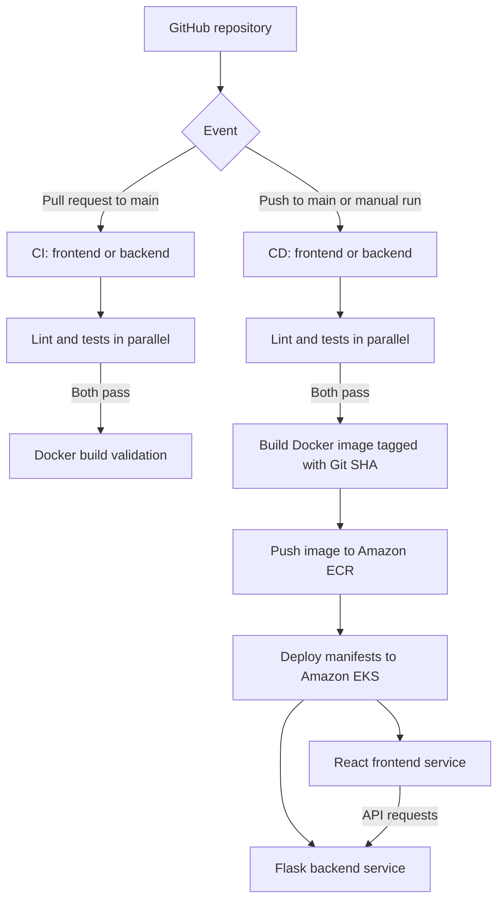

# Movie Picture Pipeline | End-to-End CI/CD on AWS

**An end-to-end DevOps implementation by Meriem Zerkouk**  
*Hands-on project · GitHub Actions · Docker · Terraform · Amazon ECR · Amazon EKS · Kubernetes*

[](https://github.com/AnesMaria/cd12354-movie-picture-pipeline/actions/workflows/frontend-ci.yaml)
[](https://github.com/AnesMaria/cd12354-movie-picture-pipeline/actions/workflows/backend-ci.yaml)
[](https://github.com/AnesMaria/cd12354-movie-picture-pipeline/actions/workflows/frontend-cd.yaml)
[](https://github.com/AnesMaria/cd12354-movie-picture-pipeline/actions/workflows/backend-cd.yaml)

## About this project

I completed this project as a hands-on exercise in **DevOps, cloud infrastructure, and CI/CD automation**. My goal was to take an existing two-tier movie catalog application and build a reliable delivery process that validates changes, packages both services as Docker images, publishes them to Amazon ECR, and deploys them to Kubernetes on Amazon EKS.

The application consists of:
- **Frontend:** a React application written in JavaScript that displays a list of movies.
- **Backend:** a Python/Flask REST API that serves the movie data through `/movies`.

The application starter code and initial deployment configuration were provided as part of the **Udacity Movie Picture Pipeline project**. My work focused on the CI/CD workflows, cloud deployment process, integration, verification, and troubleshooting.

> **What I learned and practiced:** I learned and practiced a broad range of practical DevOps skills by connecting GitHub, automated quality checks, Docker, AWS, and Kubernetes into one functioning delivery pipeline. This experience helped me understand not only how each tool works individually, but also how the tools work together to take code from a repository to a running cloud application.

## Architecture and delivery flow



**Infrastructure:** Terraform provisions the EKS cluster, an EKS worker node group, VPC networking, the frontend and backend ECR repositories, and IAM access for GitHub Actions. Kubernetes manifests are applied using `kubectl kustomize` and `kubectl apply`.

## Technology stack

| Area | Technologies |
| --- | --- |
| Frontend | React, JavaScript, Node.js, npm, ESLint, React Testing Library |
| Backend | Python 3.10, Flask, Pipenv, pytest, Flake8 |
| Automation | GitHub Actions, Git, GitHub |
| Containers | Docker, Amazon ECR |
| Infrastructure as Code | Terraform |
| Container orchestration | Kubernetes, Amazon EKS, kubectl, Kustomize |
| Cloud and access | AWS, IAM, EKS access entries, GitHub Actions secrets |

## CI/CD workflows

All four workflows are stored in `.github/workflows/`.

| Workflow | File | Trigger | Main stages |
| --- | --- | --- | --- |
| [Frontend CI](.github/workflows/frontend-ci.yaml) | `frontend-ci.yaml` | PR to `main` affecting frontend; manual | ESLint + unit tests → Docker build |
| [Backend CI](.github/workflows/backend-ci.yaml) | `backend-ci.yaml` | PR to `main` affecting backend; manual | Flake8 + pytest → Docker build |
| [Frontend CD](.github/workflows/frontend-cd.yaml) | `frontend-cd.yaml` | Push to `main` affecting frontend; manual | Lint + test → image build/push → EKS |
| [Backend CD](.github/workflows/backend-cd.yaml) | `backend-cd.yaml` | Push to `main` affecting backend; manual | Lint + test → image build/push → EKS |

**Quality gates:** lint and test jobs run independently in parallel. The `needs` dependency prevents a Docker build from starting unless both pass. For deployment, a failed build prevents the deployment job from running.

**Traceability:** deployed images are tagged with the Git commit SHA, rather than relying only on a mutable `latest` tag.

**Frontend-to-backend integration:** before building React, the frontend CD workflow discovers the backend's public Kubernetes service address (or uses the optional repository variable `REACT_APP_MOVIE_API_URL`). It passes that value into the Docker build using `--build-arg`, so the browser can request movie data from the deployed API.

**Deployment verification:** workflows wait for Kubernetes rollout completion. The backend CD also runs an in-container smoke test against the `/movies` endpoint and checks that it returns a nonempty movie list.

## Screenshots and submission evidence

I documented the completed project with six screenshots covering CI, CD, and end-to-end application functionality. The [screenshots gallery](screenshots/README.md) displays the recorded evidence alongside links to the successful GitHub Actions runs.

## Verified results

I successfully ran all four workflows and deployed both services to an EKS cluster. Kubernetes reported both application pods as `Running` with `1/1` containers ready and zero restarts during final verification.

| Evidence | Verified outcome |
| --- | --- |
| [Backend CI — successful run](https://github.com/AnesMaria/cd12354-movie-picture-pipeline/actions/runs/39875358665) | Lint, test, and build passed |
| [Frontend CI — successful run](https://github.com/AnesMaria/cd12354-movie-picture-pipeline/actions/runs/39875361227) | Lint, test, and build passed |
| [Backend CD — successful run](https://github.com/AnesMaria/cd12354-movie-picture-pipeline/actions/runs/39881585618) | Image pushed to ECR; deployment and API smoke test passed |
| [Frontend CD — successful run](https://github.com/AnesMaria/cd12354-movie-picture-pipeline/actions/runs/39884021891) | Image pushed to ECR; Kubernetes deployment passed |
| End-to-end browser verification | React displayed all three movies returned by Flask |

The deployed API returned:

```json
{
  "movies": [
    {"id": "123", "title": "Top Gun: Maverick"},
    {"id": "456", "title": "Sonic the Hedgehog"},
    {"id": "789", "title": "A Quiet Place"}
  ]
}
```

### Demonstration URLs (temporary lab infrastructure)

- **Frontend:** [Movie List application](http://ab65c4d733cd147f8956da73ddfa77ee-515836602.us-east-1.elb.amazonaws.com)
- **Backend:** [`/movies` API endpoint](http://a4984c349a485499b884aa3d86e207fe-485005192.us-east-1.elb.amazonaws.com/movies)

These HTTP endpoints belong to the temporary AWS lab environment. They may stop working when the infrastructure is destroyed. The GitHub workflow run links remain available as execution evidence, and screenshots of the working UI/API can be included in the Udacity submission.

## What I learned and practiced

This project was an opportunity to turn concepts into practical skills:

1. **CI design:** I learned to configure GitHub Actions triggers, path filters, independent jobs, dependency caching, and `needs`-based quality gates.
2. **Testing and code quality:** I practiced running ESLint, Flake8, Jest/React tests, and pytest as automated checks before packaging.
3. **Containerization:** I practiced building Docker images for JavaScript and Python applications, using build arguments, and tagging releases with Git SHAs.
4. **AWS services:** I learned how Amazon ECR stores container images and how Amazon EKS runs them as Kubernetes workloads.
5. **Infrastructure as Code:** I applied Terraform to provision a VPC, networking, IAM resources, ECR registries, and a working EKS cluster.
6. **Kubernetes operations:** I practiced working with Deployments, Pods, Services, LoadBalancers, Kustomize, rollout checks, and `kubectl` diagnostics.
7. **Cloud security:** I learned the difference between lab session credentials and IAM user access keys, and configured sensitive values using encrypted GitHub Actions secrets instead of committing them.
8. **End-to-end troubleshooting:** I diagnosed failures across Git, GitHub Actions, container registries, AWS authentication, and Kubernetes; I learned to use job logs and API checks to identify the real cause before making changes.

### Challenges I worked through

- **Git repository setup:** I dealt with an initial Git push failure and completed publication of the project and its workflows.
- **Container registry throttling:** Docker builds initially failed because Amazon ECR Public returned HTTP `429 Too Many Requests`. I switched the base image sources to Docker Hub, then verified successful CI builds.
- **AWS authentication:** the CD build initially failed with `The security token included in the request is invalid`. I traced the problem to mismatched credentials, created an IAM access key for the dedicated GitHub Actions user, corrected the repository secrets, and reran the deployment.
- **Frontend configuration:** I ensured the production React build used the backend's **public AWS address**, not `localhost:5000`.
- **Deployment verification:** I confirmed the EKS node was ready, both Pods were running, both LoadBalancer services had public addresses, and the movie list was visible in the browser.

**My main takeaway:** A successful build is only one part of delivery. A dependable CI/CD process also needs quality gates, traceable images, secure authentication, deployment checks, and functional verification from the user's perspective.

## Repository structure

```text
.github/
  workflows/
    backend-ci.yaml
    backend-cd.yaml
    frontend-ci.yaml
    frontend-cd.yaml
setup/
  terraform/           # AWS infrastructure as code
  init.sh              # Original optional helper from starter project
starter/
  backend/
    Dockerfile
    Pipfile
    k8s/
    movies/
    test_app.py
  frontend/
    Dockerfile
    package.json
    k8s/
    public/
    src/
README.md
```

## Running locally

### Backend

```bash
cd starter/backend
pipenv install
pipenv run lint
pipenv run test
pipenv run serve
```

The local API is available at `http://localhost:5000/movies`.

### Frontend (in another terminal)

```bash
cd starter/frontend
npm ci
npm run lint
CI=true npm test
REACT_APP_MOVIE_API_URL=http://localhost:5000 npm start
```

Open `http://localhost:3000`.

## Deployment notes

**Prerequisites:** an AWS account with the required permissions, Terraform, AWS CLI, Docker, and `kubectl`. The project was validated in the Udacity AWS lab in `us-east-1`.

1. Provision infrastructure from `setup/terraform` using `terraform init`, `terraform plan`, and `terraform apply`.
2. Configure the GitHub Actions secrets `AWS_ACCESS_KEY_ID` and `AWS_SECRET_ACCESS_KEY` for the dedicated IAM user authorized to push to ECR and deploy to EKS.
3. Run **Backend Continuous Deployment** first.
4. Run **Frontend Continuous Deployment** after the backend has a public LoadBalancer address.
5. Validate with `kubectl get pods`, `kubectl get svc frontend backend`, the backend `/movies` endpoint, and the frontend in a browser.

For a production system, I would replace long-lived access keys with GitHub Actions **OpenID Connect (OIDC)** credentials, scope IAM permissions more narrowly, and configure HTTPS.

### Important: clean up lab resources

AWS resources can incur costs. **After capturing evidence and completing the submission**, remove Kubernetes LoadBalancer services before destroying the Terraform infrastructure:

```bash
kubectl delete svc frontend backend
cd setup/terraform
terraform destroy
```

Run the destroy command against **the same Terraform state** used during creation; do not delete or commit `terraform.tfstate`. Never commit AWS credentials, downloaded IAM key CSV files, or Terraform state files.

## Project reflection

I am proud of completing the full path from **source code to a working cloud deployment**. More importantly, I gained practical confidence in investigating failed builds, interpreting cloud permission errors, troubleshooting Kubernetes deployments, and validating that frontend and backend services actually communicate.

This project strengthened my foundation in **DevOps engineering, CI/CD, cloud infrastructure, containerization, and automation**, and it gives me a concrete starting point for more advanced MLOps and cloud-native projects.

---

**Meriem Zerkouk**  
*Movie Picture Pipeline — hands-on DevOps / CI/CD project based on the Udacity starter application.*
