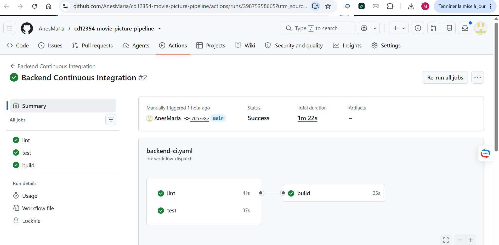
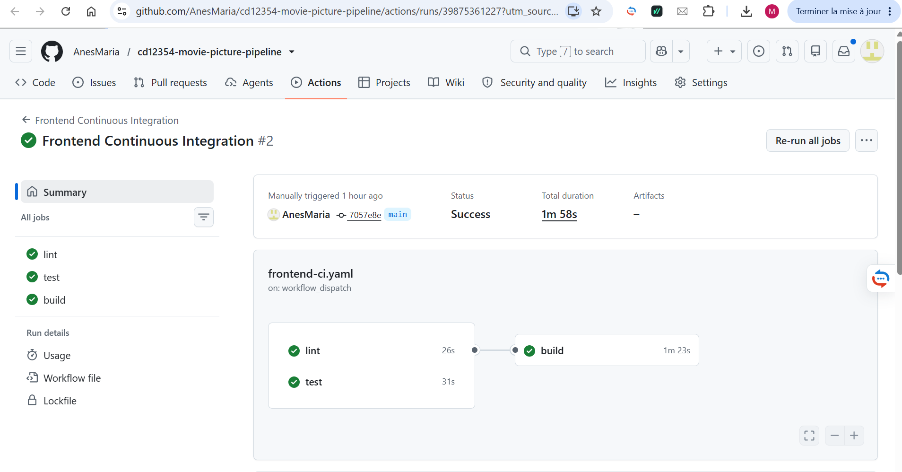
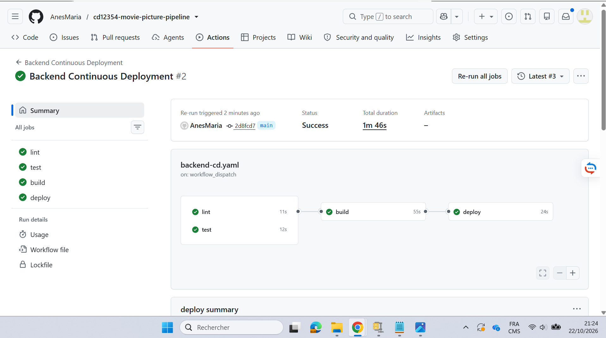
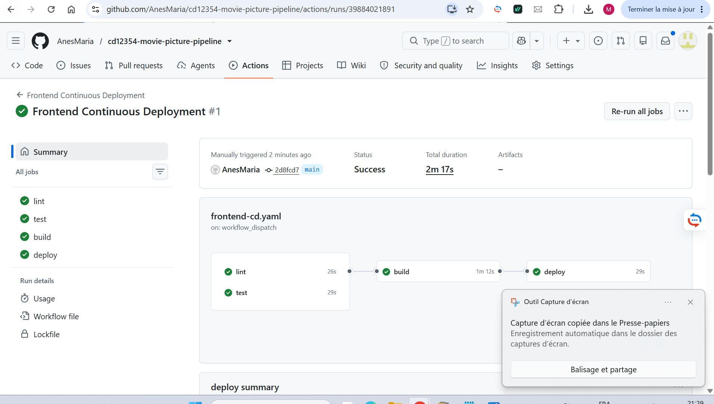
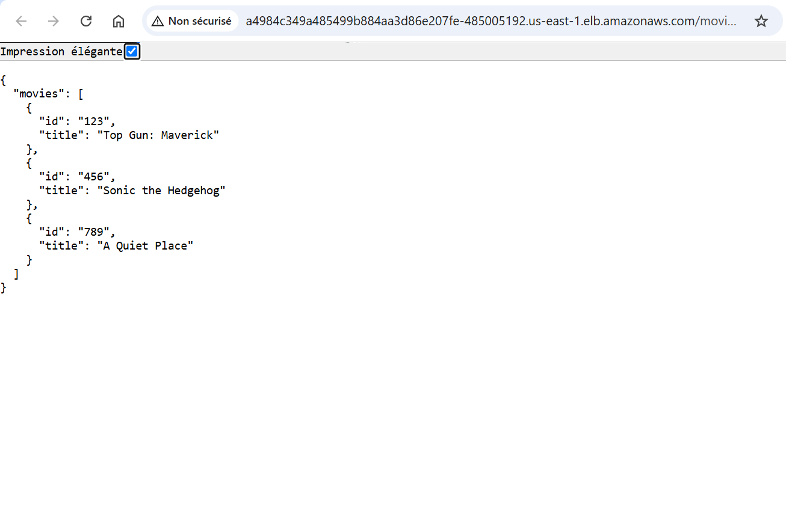
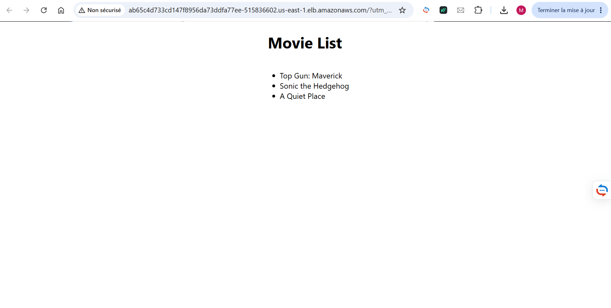

# CI/CD Screenshots — Deployment Evidence

**Movie Picture Pipeline · Meriem Zerkouk**  
Evidence collected after successfully deploying the React frontend and Flask backend to Amazon EKS.

> **Click an image to see it at full resolution.** These screenshots capture the successful runs and the end-to-end application verification. AWS demo URLs may stop working after lab cleanup, but these images remain in GitHub.

## Evidence at a glance

| Stage | Backend | Frontend |
| --- | --- | --- |
| Continuous Integration | [✅ CI run](https://github.com/AnesMaria/cd12354-movie-picture-pipeline/actions/runs/39875358665) | [✅ CI run](https://github.com/AnesMaria/cd12354-movie-picture-pipeline/actions/runs/39875361227) |
| Continuous Deployment | [✅ CD run](https://github.com/AnesMaria/cd12354-movie-picture-pipeline/actions/runs/39881585618) | [✅ CD run](https://github.com/AnesMaria/cd12354-movie-picture-pipeline/actions/runs/39884021891) |
| Application verification | Flask `/movies` API | React movie catalog |

## 1. Continuous Integration

### Figure 1 — Backend Continuous Integration

Successful linting with Flake8, unit testing with pytest, and Docker build. Lint and test run in parallel; the build depends on both.

### Figure 2 — Frontend Continuous Integration

Successful ESLint checks, JavaScript/React tests, and Docker build with the required `REACT_APP_MOVIE_API_URL` build argument.

## 2. Continuous Deployment

### Figure 3 — Backend Continuous Deployment

Successful automated lint, test, Docker image build and push to Amazon ECR, and Kubernetes deployment to EKS.

### Figure 4 — Frontend Continuous Deployment

Successful automated lint, test, Docker image build (configured with the backend URL), push to Amazon ECR, and Kubernetes deployment to EKS.

## 3. End-to-End Functional Verification

### Figure 5 — Flask Backend API Response

The deployed API returned JSON with the three expected movies.

### Figure 6 — React Frontend Movie List

The deployed React application retrieved and displayed the same movie titles from the backend API.

---

**Result:** Four successful GitHub Actions CI/CD workflows and a working two-tier application running on AWS EKS.

[← Back to project overview](../README.md)
